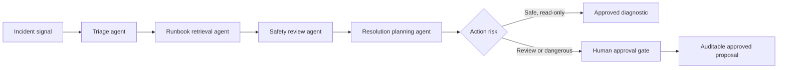

<div align="center">

# SentinelOps AI

### Explainable multi-agent incident response for Java teams

[](https://openjdk.org/)
[](https://spring.io/projects/spring-boot)
[](https://github.com/thillainirmal-tech/SentinelOps-AI/actions)
[](LICENSE)

**Triage → retrieve → review → plan. Dangerous actions always stop for a human.**

[Run locally](#run-it) · [Explore the architecture](#architecture) · [Contribute](CONTRIBUTING.md) · [Security model](docs/SECURITY_MODEL.md)

</div>

---

SentinelOps AI converts a raw production incident into an explainable response plan. Four specialized agents score severity, retrieve a grounded runbook, classify action risk and assemble an auditable plan. It is deliberately **human-controlled**: diagnostics can proceed, but production-changing commands remain blocked until an operator approves them.

The repository is a working reference for agentic architecture in Java without hiding the important parts behind an API call. Its deterministic demo engine runs offline and makes the orchestration, retrieval and safety behavior easy to test.

## Why this project is different

Most AI operations demos jump directly from a prompt to shell execution. SentinelOps treats the model as an adviser, not an administrator:

- **Evidence before action** — the triage trace explains every severity decision.
- **Grounded retrieval** — runbooks are selected with transparent cosine similarity.
- **Least agency** — commands are proposals and never execute from this application.
- **Human approval gates** — restarts, scaling and financial/security changes stay blocked.
- **Graceful offline mode** — no vendor account or API key is needed to run the full demo.
- **Production signals** — health probes and Prometheus metrics are included.

## Architecture



| Agent | Responsibility | Output |
|---|---|---|
| Triage | Score operational signals and user impact | Severity, confidence, evidence |
| Retrieval | Ground the incident in a curated runbook | Best runbook and first diagnostic step |
| Safety | Separate observation from production mutation | Risk-labelled action proposals |
| Planning | Build a concise response sequence | Auditable operator plan |

The initial knowledge base includes HTTP outages, Kafka lag, database saturation, payment authorization failures and security events. Adding a runbook is a small, contributor-friendly change.

## Live API

```http
POST /api/incidents/analyze
Content-Type: application/json

{
  "title": "Checkout API outage",
  "description": "All users receive HTTP 503 during payment authorization.",
  "service": "checkout-service"
}
```

The response contains the full agent trace and risk-labelled actions. A protected proposal can be approved explicitly:

```http
POST /api/incidents/{incidentId}/actions/{actionId}/approve
```

Approval changes the proposal state; it **does not execute the command**.

## Run it

Prerequisites: Java 17+ and Maven 3.9+.

```bash
git clone https://github.com/thillainirmal-tech/SentinelOps-AI.git
cd SentinelOps-AI
mvn spring-boot:run
```

Open [http://localhost:8080](http://localhost:8080) and choose **Run live demo**.

Useful endpoints:

- Dashboard: `http://localhost:8080`
- Health: `http://localhost:8080/actuator/health`
- Prometheus: `http://localhost:8080/actuator/prometheus`

### Docker

```bash
docker compose up --build
```

## Test it

```bash
mvn verify
```

Tests cover risk classification, retrieval quality, validation, orchestration and the human approval path.

## Roadmap

- [ ] Plug-in interface for Spring AI and LangChain4j models
- [ ] PostgreSQL/pgvector runbook store with metadata filtering
- [ ] OpenTelemetry trace correlation
- [ ] Kubernetes read-only MCP server
- [ ] Evaluation dataset for severity and retrieval quality
- [ ] Signed approvals and immutable audit events

## Contributing

Good first contributions include a new runbook, an incident evaluation case, dashboard accessibility improvements and an observability integration. See [CONTRIBUTING.md](CONTRIBUTING.md) and open an issue before larger architectural changes.

## Responsible-use note

SentinelOps AI is an educational operations copilot. Treat every generated or deterministic proposal as untrusted until it is reviewed against your environment. Never place credentials, customer data or production secrets in incident descriptions.

## License

Apache License 2.0. See [LICENSE](LICENSE).
